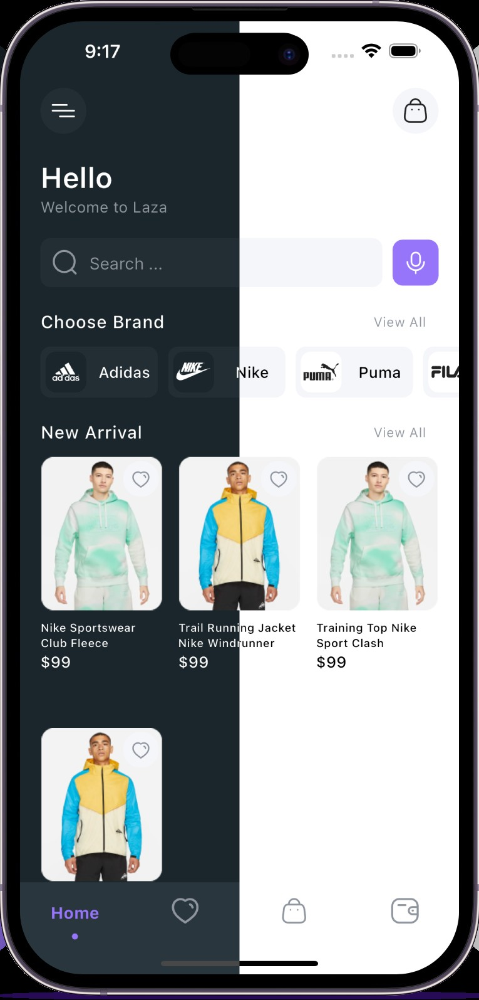

# Laza — Flutter E-commerce UI

   

> Implementasi antarmuka mobile e-commerce yang berfokus pada pengalaman katalog, detail produk, dan tema visual.

## Preview



*Potongan tampilan katalog dari screenshot yang sudah tersedia di `Laza/screenshots/laza-screenshot.png`; bukan capture baru dari emulator. Panel profil, alamat, dan informasi pembayaran tidak disertakan.*

## Tentang proyek

Implementasi antarmuka mobile e-commerce yang berfokus pada pengalaman katalog, detail produk, dan tema visual. Dokumentasi ini dibuat sebagai panduan singkat untuk memahami ruang lingkup proyek, menjalankannya secara lokal, dan membaca batasan penggunaannya.

## Fitur utama

- Dark mode
- Custom icon font
- Layout responsif untuk iOS dan Android
- Struktur asset dan screen Flutter
- Komponen UI yang mudah dikembangkan

## Teknologi

- Flutter
- Dart
- Android
- iOS

## Menjalankan secara lokal

Prasyarat dan konfigurasi dapat berbeda menurut sistem operasi. Contoh langkah utama:

```bash
flutter pub get
flutter run
```

## Struktur dan pengembangan

Mulai dari entry point dan folder konfigurasi proyek. Pisahkan credential lokal dari source code, tambahkan test untuk perubahan penting, dan gunakan environment variable untuk konfigurasi deployment.

## Keamanan

- Jangan commit API key, password, token, session ID, atau data pribadi.
- Gunakan file environment lokal dan contoh konfigurasi tanpa nilai rahasia.
- Uji perubahan pada environment development sebelum deployment.

## Status

Proyek ini merupakan bagian dari portofolio **Hilman Arifin Ilham** dan dapat dikembangkan sesuai kebutuhan penggunaan.

> **Catatan:** Repo ini berfokus pada UI/prototype. Ganti konfigurasi platform dan asset sesuai target aplikasi sebelum rilis.

## Lisensi

Belum ada lisensi open-source yang dinyatakan di repository ini. Hubungi pemilik repository sebelum menggunakan ulang atau mendistribusikan kode.

---

Dibuat oleh [Hilman Arifin Ilham](https://github.com/hilman-devop).
